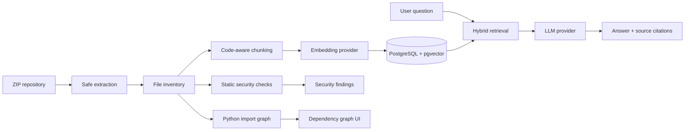

# Codebase RAG

**Codebase Intelligence and Security Analysis Platform**

Codebase RAG turns a source-code repository into an explorable, searchable knowledge base. Upload a ZIP archive, index its files, ask questions with source citations, review static security findings, and inspect internal Python import relationships.

[](https://github.com/Shlok107/AI-Powered-Codebase-RAG/actions/workflows/tests.yml)

---

## Contents

- [What it does](#what-it-does)
- [How it works](#how-it-works)
- [Technology](#technology)
- [Run locally with Docker](#run-locally-with-docker)
- [Configure AI providers](#configure-ai-providers)
- [Use the application](#use-the-application)
- [Dependency graph scope](#dependency-graph-scope)
- [Security and operational notes](#security-and-operational-notes)
- [Run tests](#run-tests)
- [Project layout](#project-layout)
- [Current limitations](#current-limitations)
- [Deployment status](#deployment-status)
- [License](#license)

## What it does

### Repository ingestion and indexing
- Upload source repositories as ZIP archives.
- Validate and extract archives with path-traversal protections and configurable size, file-count, and compression-ratio limits.
- Detect file languages and preserve repository paths and line ranges.
- Split Python source into AST-aware function/class chunks; use line-based chunking for other supported files.
- Generate and store embeddings alongside source chunks in PostgreSQL with pgvector.

### Codebase Q&A
- Ask natural-language questions about an indexed repository.
- Retrieve relevant chunks using vector similarity and keyword retrieval.
- Generate answers through an OpenAI-compatible chat-completions endpoint.
- Return file and line citations with answers.
- Use an extractive fallback when an AI model is unavailable; this fallback is not a substitute for model-generated reasoning.

### Security analysis
- Run static checks for hardcoded secrets and suspicious or dangerous code patterns.
- Inspect infrastructure configuration, including Docker-related settings.
- Check supported dependency manifests and lockfiles against the [OSV vulnerability database](https://osv.dev/).
- Review findings by severity, category, file, and status; update finding triage status.
- Surface incomplete advisory coverage rather than treating unavailable or capped checks as clean results.

### Dependency graph
- Explore resolved internal Python import relationships.
- Switch between repository overview, directory/file exploration, and a selected file's dependency view.
- Inspect incoming dependencies, outgoing dependencies, and reverse impact.
- Search files and navigate the graph with zoom, pan, selection, and layout controls.

The graph is intentionally limited to statically resolvable Python imports. See [Dependency graph scope](#dependency-graph-scope).

## How it works



The local Docker Compose stack contains three services:

| Service | Responsibility | Local address |
|---|---|---|
| `frontend` | React application served by Nginx | http://localhost:5173 |
| `backend` | FastAPI API, ingestion, indexing and analysis | http://localhost:8001 |
| `db` | PostgreSQL with pgvector | localhost:5433 |

The backend runs database migrations at container startup. Indexing and scan jobs are currently launched by the API process; this project does not currently deploy separate worker containers or an external queue.

## Technology

| Layer | Technologies |
|---|---|
| Backend | Python 3.11+, FastAPI, Pydantic v2, SQLAlchemy 2, Alembic |
| Database | PostgreSQL 16, pgvector |
| Retrieval | Vector similarity, keyword retrieval, hybrid ranking |
| Embeddings | Sentence Transformers (local) or an OpenAI-compatible embeddings endpoint |
| LLM | OpenAI-compatible chat-completions endpoint |
| Dependency analysis | Python AST, NetworkX |
| Frontend | React 18, TypeScript, Vite, Tailwind CSS, React Router |
| Runtime | Docker, Docker Compose, Nginx |
| Dependency advisories | OSV API |

## Run locally with Docker

### Prerequisites

- Docker Desktop with Docker Compose v2 (Windows/macOS) or Docker Engine with the Compose plugin (Linux).
- Git.
- An available local port for each published service: 5173, 8001 and 5433.

### 1. Clone the repository

```bash
git clone https://github.com/Shlok107/AI-Powered-Codebase-RAG.git
cd AI-Powered-Codebase-RAG
```

### 2. Create the environment file

**PowerShell (Windows):**

```powershell
Copy-Item .env.example .env
```

**macOS / Linux:**

```bash
cp .env.example .env
```

The example configuration is sufficient to start the application, but AI-powered retrieval and answers require provider configuration. See [Configure AI providers](#configure-ai-providers).

### 3. Build and start the stack

```bash
docker compose up --build -d
```

Check service status:

```bash
docker compose ps
```

Follow backend logs:

```bash
docker compose logs -f backend
```

The backend container applies Alembic migrations before starting Uvicorn. You do not need to run the migration command separately when using this Compose configuration.

### 4. Open the application

- **Frontend:** http://localhost:5173
- **Backend API:** http://localhost:8001
- **Interactive API docs:** http://localhost:8001/docs

The API documentation is enabled by the Compose development configuration.

### Stop the application

```bash
docker compose down
```

This stops and removes the containers but keeps the named database and repository-storage volumes.

To remove the volumes and permanently delete locally stored database records and uploaded repository files as well:

```bash
docker compose down -v
```

Use `down -v` only when you intentionally want to reset local application data.

## Configure AI providers

Provider settings are read from the root `.env` file by Docker Compose. The example file defaults both providers to `none`, so the application can start without external AI credentials.

### Embeddings

For local embeddings using Sentence Transformers:

```env
EMBEDDING_PROVIDER=sentence_transformers
EMBEDDING_MODEL=sentence-transformers/all-MiniLM-L6-v2
EMBEDDING_DIMENSIONS=384
```

The Docker image includes CPU PyTorch and Sentence Transformers. The model is downloaded when it is first loaded, so the first indexing run may take longer and requires network access to the model host.

For an OpenAI-compatible embedding service:

```env
EMBEDDING_PROVIDER=openai_compatible
EMBEDDING_BASE_URL=https://your-provider.example/v1
EMBEDDING_API_KEY=your-embedding-key
EMBEDDING_MODEL=your-embedding-model
EMBEDDING_DIMENSIONS=384
```

Set `EMBEDDING_DIMENSIONS` to the actual output size of the selected model. It must match the vector column/index configuration used by the application.

### Chat model

For an OpenAI-compatible chat endpoint:

```env
LLM_PROVIDER=openai_compatible
LLM_BASE_URL=https://your-provider.example/v1
LLM_API_KEY=your-chat-key
LLM_MODEL=your-chat-model
```

For a local Ollama-compatible service running on the host while the backend is in Docker, use the host gateway rather than `localhost`:

```env
LLM_PROVIDER=openai_compatible
LLM_BASE_URL=http://host.docker.internal:11434/v1
LLM_API_KEY=ollama
LLM_MODEL=your-installed-model
```

The model name must match a model served by your endpoint. The endpoint must expose the OpenAI-compatible `/chat/completions` API. The embedding endpoint, if used, must expose `/embeddings`.

> **Cost note:** Local Sentence Transformers embeddings do not require a paid API. A local chat model can also avoid per-request model API charges, but it requires suitable local hardware and a running inference server. OSV dependency-advisory lookups use the external OSV service.

### Other useful settings

Most limits and defaults are documented inline in [`.env.example`](.env.example).

| Variable | Purpose | Example default |
|---|---|---|
| `MAX_UPLOAD_MB` | Maximum ZIP upload size | `50` |
| `MAX_ARCHIVE_FILES` | Maximum archive entries | `10000` |
| `MAX_UNCOMPRESSED_MB` | Maximum total extracted size | `300` |
| `MAX_SINGLE_FILE_MB` | Maximum size of one indexed file | `5` |
| `MAX_ARCHIVE_PATH_LENGTH` | Maximum archive path length | `1024` |
| `MAX_ARCHIVE_COMPRESSION_RATIO` | Maximum accepted compression ratio | `1000` |
| `MAX_DEPENDENCY_QUERIES` | Maximum OSV queries in a scan | `1000` |
| `MAX_DEPENDENCY_ADVISORIES` | Maximum advisories processed per scan | `100` |
| `CHUNK_SIZE` / `CHUNK_OVERLAP` | Chunking configuration | `1200` / `150` |
| `RETRIEVAL_TOP_K` | Retrieval result limit | `6` |

## Use the application

1. **Upload a repository.** Open **Repositories**, choose **Add repository**, and upload a ZIP archive (maximum 50 MiB by default).
2. **Wait for indexing.** The repository moves through its processing states. Once indexed, its chunks are available for retrieval.
3. **Ask questions.** Open **Ask Codebase**, select the repository, and submit a question. Answers include source citations when evidence is retrieved.
4. **Run a security scan.** Open **Security**, select a repository, and start a scan. Review findings and update their triage status.
5. **Explore dependencies.** Open **Dependency Graph**, select an indexed repository, and inspect its Python import relationships.

## Dependency graph scope

The dependency graph is a computed-on-request view of source files stored for an indexed repository.

- **Supported language:** Python.
- **Relationship type:** Resolvable internal imports found through Python AST parsing.
- **Not modeled:** JavaScript/TypeScript or other language imports, runtime call graphs, dynamic imports that cannot be resolved statically, and external package dependency edges.
- **Coverage:** Parse failures and unresolved imports are not converted into guessed relationships. The UI reports partial Python coverage.
- **Response bounds:** The graph service caps the response at 250 files and 800 relationships.
- **Persistence:** Graphs are recomputed from repository source when requested; graph relationships are not stored in separate database tables.

The graph describes static import relationships, not proof that a module is executed at runtime or a complete representation of every dependency.

## Security and operational notes

### Archive handling and source processing

- ZIP extraction validates paths and enforces configurable upload, entry-count, per-file, aggregate expansion, path-length and compression-ratio limits.
- Uploaded source code is parsed and analyzed; it is not executed or imported by the indexing or dependency-graph pipeline.
- Secret-like values in findings and logs are handled with redaction safeguards.

### Dependency vulnerability coverage

The dependency scanner queries OSV for exact versions it can resolve from supported manifest and lockfile formats, including requirements files, `pyproject.toml`, npm lockfiles, Poetry/uv lockfiles, `Cargo.lock`, and `go.mod`.

It does not resolve arbitrary version ranges from unlocked manifests or provide a general package-freshness assessment. Unavailable services, malformed manifests and configured work limits are reported as incomplete coverage, not as a clean scan.

### Network exposure

The Compose ports bind to loopback (`127.0.0.1`) for local development. The API currently has **no authentication or per-user repository authorization**. Do not expose this stack directly to a LAN or the public internet.

A production deployment would need, at minimum, authentication, repository-level authorization, TLS, managed secrets, production database credentials, and appropriate API/operation rate limits. CORS settings alone are not an access-control mechanism.

## Run tests

### Backend

```bash
cd backend
python -m venv .venv
```

Activate the environment:

**PowerShell:**

```powershell
.\.venv\Scripts\Activate.ps1
```

**macOS / Linux:**

```bash
source .venv/bin/activate
```

Install backend development and local-embedding dependencies, then run tests:

```bash
python -m pip install -e ".[dev,local-embeddings]"
python -m pytest
```

Database-backed tests require `TEST_DATABASE_URL` to point to an isolated PostgreSQL database with pgvector enabled. The test configuration rejects database names that do not contain `test`; do not point it at your development database.

### Frontend

```bash
cd frontend
npm ci
npm test
npm run test:coverage
npm run build
```

The frontend development server is available with `npm run dev` (Vite, port 5173).

### Continuous integration

The GitHub Actions workflow in [`.github/workflows/tests.yml`](.github/workflows/tests.yml) runs backend tests with PostgreSQL/pgvector, dependency audits, frontend tests with coverage, and a production frontend build.

## Project layout

```text
.
├── backend/
│   ├── app/
│   │   ├── api/routes/       # FastAPI endpoints
│   │   ├── core/             # Settings, logging, request limits
│   │   ├── db/               # SQLAlchemy models and sessions
│   │   ├── services/         # Ingestion, chunking, RAG, security, graph
│   │   ├── workers/          # Indexing and security scan jobs
│   │   └── tests/            # Unit and integration tests
│   ├── alembic/              # Database migrations
│   ├── Dockerfile
│   └── pyproject.toml
├── frontend/
│   ├── src/
│   │   ├── api/              # Backend API client
│   │   ├── components/       # Shared UI components
│   │   ├── layouts/          # Application layout
│   │   ├── pages/            # Application pages
│   │   ├── types/            # TypeScript types
│   │   └── utils/            # Frontend utilities
│   ├── Dockerfile
│   └── package.json
├── sample-repo/              # Sample source repository
├── scripts/                  # Project helper scripts
├── docker-compose.yml
├── .env.example
└── README.md
```

## Current limitations

- ZIP upload is the supported repository-ingestion path; a Git URL connector is not implemented.
- Dependency graph coverage is currently limited to statically resolvable Python imports.
- Conversation history is not persisted as a durable server-side chat session.
- Security analysis is static and rule-based; findings should be reviewed in context and are not a guarantee that a repository is secure.
- OSV advisory coverage depends on external service availability and exact versions that can be resolved from supported files.
- The API is a local-development MVP and is not production-hardened or access-controlled.

## Deployment status

The application currently runs locally through Docker Compose. AWS deployment is **not implemented**. The `AWS_REGION`, `S3_BUCKET`, and `SQS_QUEUE_URL` entries in `.env.example` are configuration placeholders; they do not provision or connect the application to ECS, S3, RDS or SQS.

## License

No license file has been added. All rights are reserved unless and until a license is provided.
