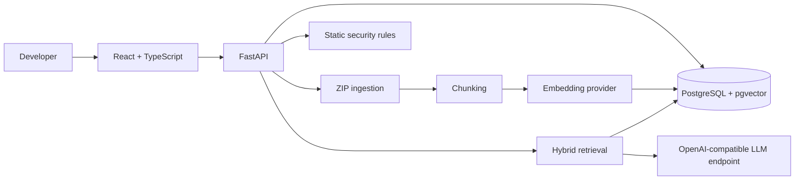

# Codebase RAG

**Codebase intelligence and security analysis platform**

Codebase RAG is a full-stack application for uploading a source-code repository, indexing its contents, asking questions grounded in retrieved code, and reviewing static security/configuration findings.

> **Project status:** MVP. The core local Docker workflow has been exercised, but automated test coverage is not yet in place. Nemotron configuration is supported through an OpenAI-compatible endpoint; a live Nemotron deployment has not been verified.

## What it does

- **Repository ingestion:** Accepts ZIP uploads and applies path-traversal and decompression limits during extraction.
- **Code indexing:** Uses Python AST-based chunking for Python definitions and line-based chunking as a fallback for other content.
- **Hybrid retrieval:** Combines PostgreSQL full-text search with pgvector similarity search, then merges rankings using reciprocal rank fusion.
- **Grounded code Q&A:** Builds answers from retrieved source chunks and validates source references before returning them.
- **Static security checks:** Runs deterministic rules for exposed secrets, dangerous code patterns, selected dependency versions, and infrastructure/configuration issues.
- **Developer dashboard:** React interface for repository management, chat, scan results, and system status.

## Architecture



### Technology

| Layer | Technologies |
|---|---|
| Frontend | React 18, TypeScript, Vite, Tailwind CSS |
| API | Python 3.11+, FastAPI, Pydantic |
| Persistence | PostgreSQL, SQLAlchemy 2.x, Alembic |
| Retrieval | pgvector, PostgreSQL full-text search, reciprocal rank fusion |
| Runtime | Docker, Docker Compose |
| Optional AI providers | OpenAI-compatible chat/embedding endpoints; sentence-transformers for local embeddings |

## Run locally with Docker

### Prerequisites

- Docker Desktop or Docker Engine with the Compose plugin
- Git

### Start

```bash
git clone https://github.com/Shlok107/AI-Powered-Codebase-RAG.git
cd AI-Powered-Codebase-RAG
cp .env.example .env
docker compose up --build -d
```

The Compose configuration starts PostgreSQL/pgvector, the FastAPI backend, and the frontend. The backend container runs database migrations on startup.

Open:

- Frontend: http://localhost:5173
- API: http://localhost:8000
- Interactive API docs: http://localhost:8000/docs

To inspect service logs:

```bash
docker compose logs -f backend
docker compose logs -f frontend
```

To stop the stack:

```bash
docker compose down
```

To remove the local database and repository volumes as well:

```bash
docker compose down -v
```

**Warning:** `docker compose down -v` deletes the persisted local database and uploaded repository data.

## Configure AI providers

The app can run with providers unconfigured, but AI-powered answers and embeddings require compatible provider settings. Copy `.env.example` to `.env` and configure the relevant variables.

Example chat configuration for an OpenAI-compatible endpoint:

```env
LLM_PROVIDER=openai_compatible
LLM_BASE_URL=https://your-provider.example/v1
LLM_API_KEY=your-api-key
LLM_MODEL=your-model-name
```

For a local server exposing an OpenAI-compatible API, use that server's reachable base URL and model identifier. The repository's Nemotron settings are configuration examples only; the actual Nemotron endpoint and model response have not been integration-tested.

Embedding configuration is separate from chat configuration. Set `EMBEDDING_PROVIDER`, `EMBEDDING_BASE_URL` / `EMBEDDING_API_KEY` when applicable, `EMBEDDING_MODEL`, and `EMBEDDING_DIMENSIONS` to match the selected provider. The vector dimensions must match the database schema/index.

See [`.env.example`](.env.example) for the available settings. Do not commit a populated `.env` file or real credentials.

## Current limitations

- ZIP upload is the repository ingestion path; a Git URL connector is not implemented.
- Python receives AST-aware chunking. Other supported file types currently use line-based chunking; Tree-sitter parsing is not implemented in the inspected chunking service.
- Dependency checks are limited local version rules. There is no OSV/GitHub Advisory API integration, transitive dependency resolution, or comprehensive CVE database.
- The dependency graph page is a placeholder and is not presented as a working feature.
- Chat history is not persisted across sessions.
- Automated backend and frontend test suites are not yet implemented.
- Nemotron is not verified against a live endpoint.
- AWS ECS/S3/RDS/SQS deployment is not implemented or documented as a working deployment.

## Engineering status

The checked-in engineering audit records successful local Docker workflow checks and a successful frontend production build in its audit environment. It also records missing automated tests and incomplete cloud-deployment work. Those results are environment-specific and should not be interpreted as a guarantee that every deployment will work unchanged.

## Repository layout

```text
backend/       FastAPI application, database models, services, workers, migrations
frontend/      React + TypeScript application
sample-repo/   Sample source repository used during development
docker-compose.yml
.env.example
```

## Contributing

1. Create a focused branch.
2. Keep changes scoped to one concern.
3. Add tests for new behavior when test coverage is introduced.
4. Document configuration and operational limitations.
5. Open a pull request describing the change and how it was verified.

## License

No license file is currently included. All rights are reserved by default unless a license is added by the repository owner.
